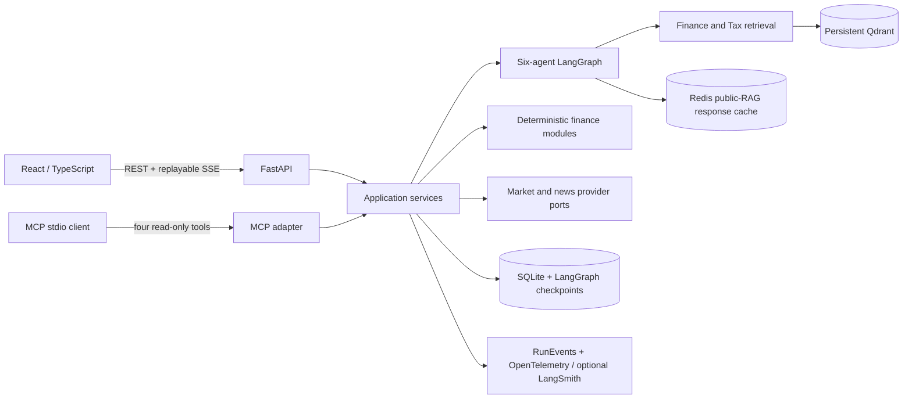

# Developer and clean-start guide

## Architecture at a glance



REST remains authoritative for the web application. The MCP adapter is a second, read-only
protocol boundary over the same validated modules; it does not expose Sessions, saved artifacts,
administration, or mutation. Read [ADR-010 and ADR-011](../02_architecture_decision_records.md)
before changing either boundary.

## Prerequisites

- Python 3.11.5+ and `uv`
- Node.js 22+ and pnpm 11
- Docker with Compose v2

From a clean checkout:

```bash
make backend-sync
make frontend-install
cp .env.example backend/.env
docker compose config --quiet
make qdrant-up
make response-cache-up
make knowledge-finance
make knowledge-tax
make knowledge-validate
```

The tracked lockfiles are the dependency authority. The default `.env.example` is credential-free,
loopback-only, and uses deterministic providers/models. Runtime only validates active Qdrant
collections; it never downloads models or regenerates embeddings on startup. If the Compose volume
does not already contain the active collections, build them deliberately with `make
knowledge-finance` and `make knowledge-tax`; those commands may fetch only approved registry
sources.

The default configuration uses deterministic credential-free models and synthetic market/news providers.
For the real OpenAI-backed assistant, backend/.env additionally needs:

```bash
AIFA_MODEL_MODE=openai_live
AIFA_OPENAI_API_KEY=...
AIFA_OPENAI_TERMS_APPROVED=true
```

The copied environment also owns three distinct runtime identities:

- `AIFA_WORKFLOW_ID` is persisted on Runs and forms part of the LangGraph checkpoint namespace. Do
  not change it while existing Session checkpoints must remain addressable.
- `AIFA_LANGSMITH_PROJECT` selects the optional LangSmith destination; it does not rename Runs.
- `AIFA_OTEL_SERVICE_NAME` identifies this backend to OpenTelemetry collectors.

Ordinary backend and frontend tests use their tracked, credential-free test environments and do
not inherit these identity values from a developer's local `.env`.

Run the backend and frontend in separate terminals:

```bash
make backend-dev
make frontend-dev
```

Run the final package gate with `make m9-check`. Ordinary tests load `backend/.test.env`, ignore
developer `.env`, exclude explicit live markers, and require no paid credentials.

## Module boundaries

- `ai_finance_assistant.finance`: deterministic Portfolio import/analysis and Goal projection.
- `ai_finance_assistant.providers`: provider ports, synthetic fakes, conditional live adapters, and
  durable historical cache.
- `ai_finance_assistant.knowledge`: offline ingestion, active-collection validation, and hybrid
  dense/sparse retrieval.
- `ai_finance_assistant.workflow`: exactly six agents, conditional graph edges, checkpoint context,
  and bounded synthesis.
- `ai_finance_assistant.api`: versioned REST/SSE, authorization, persistence, and lifecycle.
- `ai_finance_assistant.mcp_adapter`: read-only protocol mapping to shared application modules.
- `ai_finance_assistant.observability`: authoritative RunEvents plus optional telemetry adapters.

## MCP client setup

The server uses stdio, so the client must launch it from the backend directory. Replace
`/absolute/path/to/repository` with the checkout path:

```json
{
  "mcpServers": {
    "ai-finance-assistant": {
      "command": "/absolute/path/to/repository/backend/.venv/bin/python",
      "args": ["-m", "ai_finance_assistant.mcp_adapter"],
      "cwd": "/absolute/path/to/repository/backend",
      "env": {"AIFA_ENV_FILE": ".env"}
    }
  }
}
```

Exposed tools are `search_education`, `get_market_quote`, `analyze_portfolio`, and `project_goal`.
Every tool advertises read-only/non-destructive annotations. `analyze_portfolio` accepts an
in-memory import and stores nothing. The external-client proof is in the [MCP client
record](../evidence/m9/mcp-client-record.md).

## Technology substitutions for coursework

React/TypeScript replaces the historically named Streamlit UI because the product requires
versioned FastAPI contracts, replayable SSE, responsive accessible views, and a measured React Flow
Inspector. Qdrant replaces the historically named FAISS option because persistent named dense and
sparse vectors, metadata filters, atomic aliases, and offline activation are product requirements.
These are equivalent-or-stronger engineering choices, not a claim that an instructor has approved
grading equivalence; that confirmation remains external.
